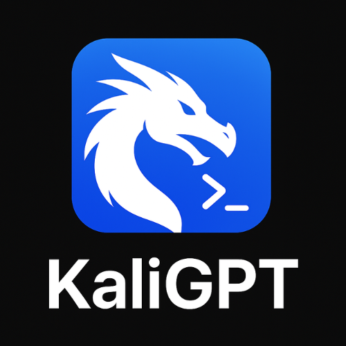

<div align="center">

  

  # KaliGPT (`kaligpt07`)
  
  ### ⚡ Autonomous AI Penetration Testing Assistant for Kali Linux ⚡

  <p align="center">
    <a href="https://github.com/kaligpt07/kaligpt"></a>
    <a href="https://kaligpt.co.in/"></a>
    <a href="#-token-contract-address-ca-announcement"></a>
  </p>

  <p align="center">
    
    
    
    
    
  </p>

</div>

---

### 🚨 TOKEN CONTRACT ADDRESS (CA) ANNOUNCEMENT

> [!IMPORTANT]
> ### CONTRACT ADDRESS (CA): **SOON AVAILABLE**
> The official **KaliGPT** token contract address has **NOT** been deployed yet.
> - Official CA will **ONLY** be published directly on this profile, the [main repository (`kaligpt07/kaligpt`)](https://github.com/kaligpt07/kaligpt), and the [official website](https://kaligpt.co.in/).
> - Beware of counterfeit tokens, imitation contracts, or unofficial presales. Always verify through official channels.

---

## 🎯 About KaliGPT

**KaliGPT** is an open-source, production-ready AI offensive security co-pilot specifically tailored for Kali Linux workflows. It combines real-time terminal heuristics via native pseudo-terminals (PTY) with multi-model LLM reasoning to assist penetration testers, ethical hackers, and red teams.

### 🌟 Core Capabilities

- ⚡ **Real-Time Terminal Capture**: Hooks directly into running terminal sessions via PTY without output buffering lag.
- 🧠 **Tactical Decision Engine**: Maps target reconnaissance output against PTES and OWASP testing frameworks to recommend next optimal commands.
- 💉 **Automated Exploit & Payload Synthesizer**: Generates custom reverse shells, SQLi vectors, XSS payloads, and privilege escalation scripts across 16+ programming languages.
- 🖥️ **Tri-Interface Ecosystem**:
  - **Tkinter Desktop GUI**: Native dark-mode Kali interface with multi-tab workspace and payload clipboard.
  - **Flask Web GUI**: Browser-based control center with real-time WebSockets and remote session orchestration.
  - **Interactive CLI**: Fast, terminal-native shell with safe-mode execution boundaries.
- 🤖 **Universal LLM Flexibility**: Run completely private and offline with local Ollama models (LLaMA 3, Mistral, Qwen) or connect to cloud models (OpenAI, Anthropic Claude, Google Gemini).
- 📊 **Automated Penetration Testing Reports**: Export executive and technical findings to Markdown, HTML, JSON, and PDF formats.

---

## 🚀 Quick Start

Deploy KaliGPT on your Kali Linux system in under 60 seconds using the automated interactive installer:

```bash
git clone https://github.com/kaligpt07/kaligpt.git && cd kaligpt && chmod +x scripts/installer.sh && ./scripts/installer.sh
```

### Run KaliGPT:

```bash
# Launch Desktop GUI
python3 ui/gui.py

# Launch Web Dashboard (http://localhost:5000)
python3 ui/web_gui.py

# Launch Interactive CLI Shell
python3 kaligpt.py --interactive
```

---

## 🌐 Official Links & Resources

| Resource | Link |
| :--- | :--- |
| 🛡️ **Flagship Repository** | [github.com/kaligpt07/kaligpt](https://github.com/kaligpt07/kaligpt) |
| 🌍 **Official Website & Live Demo** | [kaligpt.co.in](https://kaligpt.co.in/) |
| 📚 **Documentation Hub** | [kaligpt07/kaligpt/tree/main/docs](https://github.com/kaligpt07/kaligpt/tree/main/docs) |
| 📦 **Latest Release (v1.2.0)** | [kaligpt07/kaligpt/releases](https://github.com/kaligpt07/kaligpt/releases) |
| 🐞 **Issue Tracker** | [kaligpt07/kaligpt/issues](https://github.com/kaligpt07/kaligpt/issues) |

---

## 🛡️ Disclaimer

KaliGPT is created strictly for educational purposes, authorized security research, and legitimate penetration testing engagements. Always obtain explicit written permission from the system owner before conducting security assessments.

---

<div align="center">
  <sub>© 2026 KaliGPT. Open source under the MIT License.</sub>
</div>
